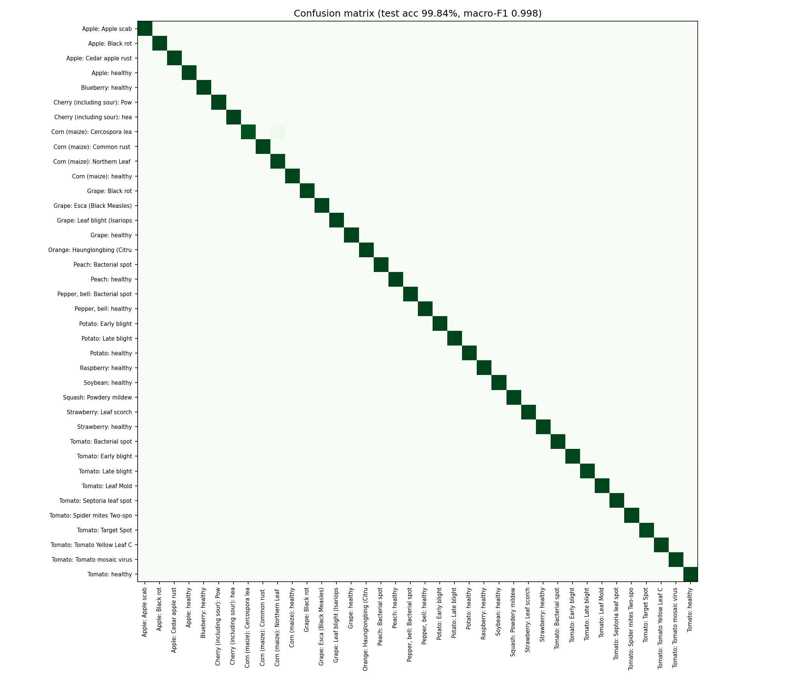
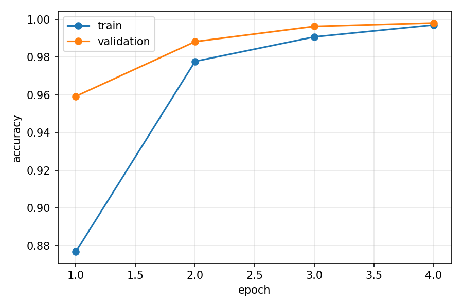

# 🌾 AgriMind: Multi-Agent AI Crop Intelligence (PS14)

Five cooperating AI agents (**Weather · Disease · Irrigation · Yield · Advisory**) share one *blackboard*,
talk to each other live on screen, and turn a leaf photo + soil card + live forecast into a
growth-stage-aware action plan in **English, Hindi and Telugu**, with voice, WhatsApp sharing and a printable report.

**Live demo:** https://agrimind-nzbr.onrender.com  (free server: the first visit may take about a minute to wake up)

## Results

| Component | Result |
|---|---|
| Disease CNN (MobileNetV3-Large, 38 classes) | **99.84% test accuracy**, macro-F1 0.998 on 8,786 unseen images |
| Training | 70,295 images, 4 epochs, ~40 min on a Kaggle T4 GPU |
| Yield model (HistGradientBoosting) | R² 0.973 on 8,000 held-out samples (agronomic simulation, see below) |
| Demo scenario (tomato, early blight on 51% of leaf, rain on day 2) | Yield −52% if no action → −35% with plan · ₹30,694 protected on 2 acres · 66% less water |




Sample photos in `samples/` (tomato early blight, healthy tomato, leaf curl virus, potato early blight, maize rust) are from the dataset's separate `test` folder.

---

## 1. Run it (5 minutes)

```bash
cd agrimind
python -m venv .venv
# Windows: .venv\Scripts\activate      Mac/Linux: source .venv/bin/activate
pip install -r requirements.txt
#   (PyTorch is big. CPU-only version:  pip install torch torchvision --index-url https://download.pytorch.org/whl/cpu)
python run.py
```
On Windows you can simply double-click **`start_agrimind.bat`** (stops any old copy, then starts the app).

Open **http://localhost:8000** · API docs at **http://localhost:8000/docs**

Works immediately, even before you train anything:
* Disease Agent uses OpenCV lesion analysis until `models/disease_model.pt` exists
* Yield model trains itself on first start (~10 s) → `models/yield_model.joblib`
* Weather is live from Open-Meteo (no key). If Wi-Fi fails, it uses the last cached forecast automatically.

## 2. Train the disease CNN

See the header of `training/train_disease.py`. Short version:
1. kaggle.com → New Notebook → Accelerator **GPU T4 x2** → Add Input **"New Plant Diseases Dataset"**
2. Upload `training/train_disease.py`, run
   `!python train_disease.py --data "<folder containing train/ and valid/>" --epochs 4`
3. Download `disease_model.pt`, `metrics.json`, `confusion_matrix.png`, `training_curves.png` → put in `models/`
4. Restart `python run.py`. The header pill turns green: **CNN ✓ … test acc 98.x%**, and Grad-CAM appears.

**Demo photos:** copy 3-4 leaf images from the dataset (e.g. `Tomato___Early_blight`, `Tomato___Late_blight`,
`Tomato___healthy`) into `samples/`, naming them like `tomato_early_blight.jpg`. They appear as one-click thumbnails, and
the "Tomato · blight" scenario auto-selects any file with *blight* in its name.

## 3. Optional: LLM (voice summary in Telugu/Hindi + "Ask AgriMind" chat)
Copy `.env.example` → `.env` and add a free Groq key (console.groq.com). Without it, everything still works with rule-based advice.

---

## 4. Architecture

```
 Leaf photo ─┐   Soil card ─┐   Location ─┐   Sowing date ─┐
             ▼              ▼             ▼                ▼
     ┌──────────────────── SHARED BLACKBOARD (facts + messages) ────────────────────┐
     │ crop.stage │ weather.forecast │ disease.diagnosis │ irrigation.plan │ yield… │
     └───▲──────────────▲──────────────────▲────────────────────▲─────────────▲─────┘
         │              │                  │                    │             │
   🌦 Weather      🔬 Disease         💧 Irrigation         📈 Yield      🧑‍🌾 Advisory
   Open-Meteo,     MobileNetV3 CNN,   FAO-56 soil-water     Gradient-      prioritises,
   ET₀, risk       Grad-CAM, OpenCV   balance, rain-aware,  boosted model, explains "why",
   flags           severity, spread   disease-aware method  3 scenarios,   EN/HI/TE, voice,
                   projection                               loss attribution WhatsApp
                                    ▼
                    Streaming dashboard (NDJSON, live agent conversation)
```

**How the agents cooperate:**
| From → To | What they exchange | Effect |
|---|---|---|
| Weather → Disease | humid / leaf-wetness days | disease spread projection speeds up |
| Weather → Irrigation | rain forecast, ET₀ | irrigation postponed / reduced before rain |
| Disease → Irrigation | "leaf-wetness pathogen" | switches sprinkler → drip, morning watering |
| Disease → Yield | projected severity, treated vs untreated | yield loss scenarios |
| Irrigation → Yield | water-stress factor with/without plan | yield loss scenarios |
| Weather → Advisory | dry window, rain timing | "spray TODAY before rain" vs "wait until Sat" |
| All → Advisory | everything | one ranked plan with reasons + ₹ value |

**Growth-stage awareness:** stage comes from days after sowing (FAO-56 stage lengths) and changes
Kc (water need), the irrigation trigger (stricter at flowering), heat-stress weight, disease-loss weight,
and the nutrient advice (N at vegetative, K at flowering, stop irrigation before harvest).

## 5. Project map
```
app/agents/      weather, disease, irrigation, yield, advisory agents
app/core/        blackboard, orchestrator, crop & disease knowledge bases, i18n, LLM
app/ml/          CNN + Grad-CAM, OpenCV severity, yield model
training/        train_disease.py (Kaggle GPU), train_yield.py
static/          dashboard (vanilla JS + SVG charts; no CDN needed)
models/          trained weights go here
samples/         demo leaf photos go here
```
Advice is decision support. Chemical doses must be confirmed on the product label and with the local KVK.
